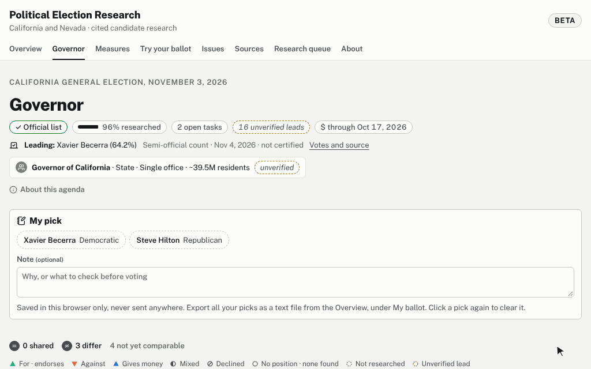
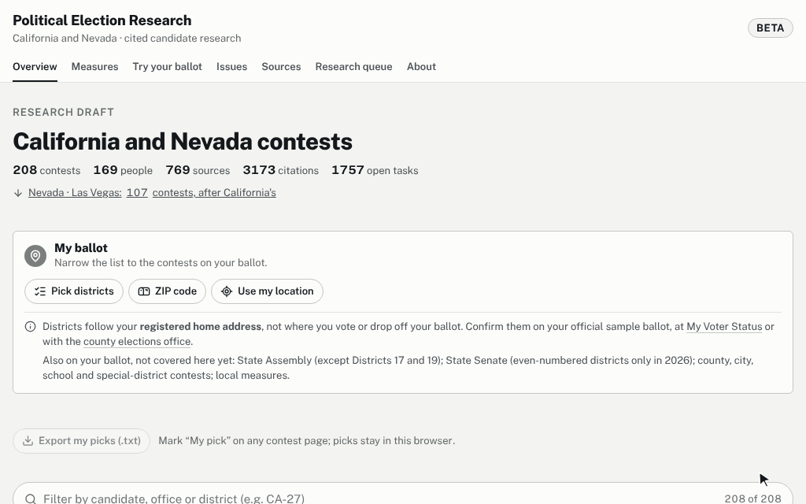
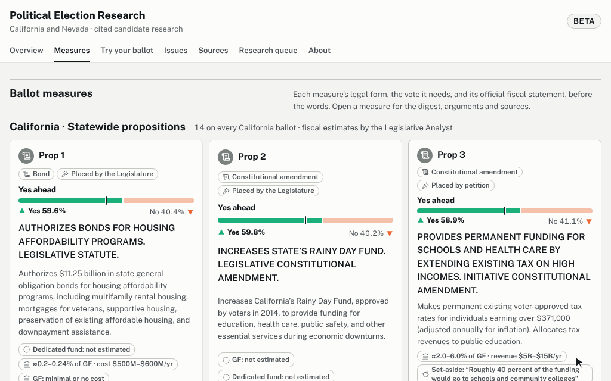
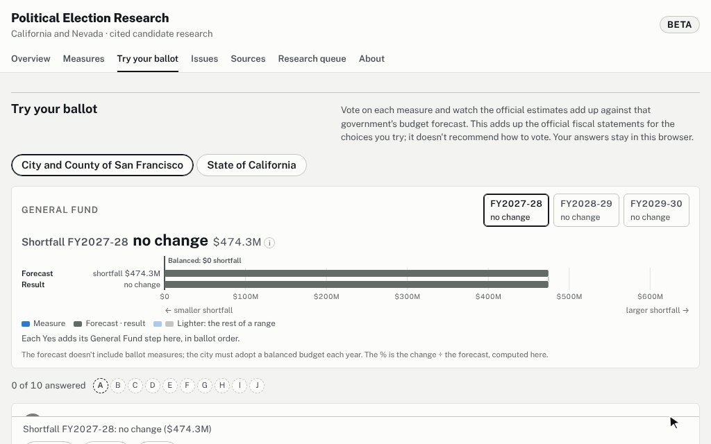

# Political Election Research

An open, **cited**, machine-checkable dataset on California elections. For each contest it records:

- where each candidate stands on specific issues (and ballot measures);
- who endorses them;
- who funds them **and their endorsers**: contributions, independent expenditures, lobbying and behested payments, each traced to official filings.

**Live beta:** https://political-election-research.vercel.app/

**The promise: every claim has a citation.** A citation names a registered source, quotes it verbatim (or gives the schedule/line of a filing), and points to an archived snapshot. Research gaps are recorded explicitly with a log of where we looked. Nothing is inferred and nothing comes from memory.

The first target is the **California general election of November 3, 2026**: Governor, the other statewide offices, the 52 US House seats, and the statewide propositions. The data is tagged by election cycle so it remains a lasting archive and can be reused for later elections.

## Built for agentic research

The system is **deterministic** so that AI agents (and people) can research candidates in parallel and produce reviewable results:

- **Fixed paths, ids and bytes.** File locations and ids are computed from content, and JSON is written in canonical form. The same facts always produce the same files.
- **A computed work queue.** Each contest has a research agenda fixed in advance (candidates, questions, measures, targets). `npm run next` compares it with the verified data and returns tasks in a fixed order, interleaved across candidates.
- **One write path.** `npm run put` computes ids and paths, fills defaults, checks the schema, and only then writes.
- **Strict checks.** `npm run validate` checks schemas, references, citations, money sourcing, dates and privacy. Every check has a rule code and a test.

See **[AGENTS.md](AGENTS.md)** for the research loop.

## The site

`npm run web` starts the Svelte site, which reloads live as data changes. `npm run web:build` writes the page to `dist/web/index.html` and the data it loads on demand to `dist/web/data/` (candidate records, leads, the research queue, My ballot's district files), so the Overview opens without them. Serve the folder from any static host; a browser won't fetch the data files from a page opened as a local file. Each contest is a side-by-side comparison in eleven categories (identity, occupation, qualifications, past policies, shared policies, policy differences, endorsements, campaign financing, performance record, controversies, promises). Every entry opens to its sources. "Try your ballot" adds up the official fiscal estimates of the measures a visitor votes for, against San Francisco's or California's budget forecast. The About page switches between the real data and a fictional demo of a fully researched contest.

**A contest.** The count line names the leader, and the other side is dimmed. Each row opens to the candidates' own words, and each number opens the source with its verbatim quote.



**Results and My ballot.** The Overview opens with the results so far. A ZIP code, the device's location or a district pick then narrows it to one voter's contests, county included. The lookup runs in the page, and nothing is sent anywhere.



**Measures.** Yes/no bars from the semi-official count, with a tick at the share needed to pass. Each measure page has its digest, fiscal statement and arguments.



**Try your ballot.** Each vote adds the official fiscal estimates to the budget forecast. It adds up; it doesn't recommend.



The GIFs are recorded from the built site by `node docs/media/record.mjs`. Re-record them after visible changes to these pages.

## Deploy (Vercel)

The site is one static file, so any static host works. [`vercel.json`](vercel.json) sets up Vercel: install with `npm ci`, build with `npm run web:build`, serve `dist/web`, and send the response headers. The security policy lets the page send data only to its own site (`connect-src 'self'`, for page views) and not to any other server, allows its fonts from Google Fonts, allows location for this site only, and sends no referrer. Routes live in the URL hash, so no rewrites are needed, and nothing a visitor enters reaches the server.

**Page views** are counted with [Vercel Web Analytics](https://vercel.com/docs/analytics) (`@vercel/analytics`, started in `web/src/main.ts`), on https://political-election-research.vercel.app only: not on preview deployments, `npm run web`, the browser checks' local server or the claude.ai preview. Vercel's script loads from the site itself (`/_vercel/insights/script.js`) and posts each page view back to it (`/_vercel/insights/view`). The page passes it a `beforeSend` hook ([`web/src/lib/analytics.ts`](web/src/lib/analytics.ts)) that cuts the reported address at the first `#` or `?`, so every page view is reported as `/`: the hash (routes, the districts My ballot puts there) never leaves the browser, and trial-ballot answers and the device's location are never in the address at all. According to Vercel, Web Analytics [stores only anonymized data and uses no cookies](https://vercel.com/docs/analytics#how-visitors-are-determined); its [privacy page](https://vercel.com/docs/analytics/privacy-policy#data-point-information) lists what it may record with each page view, such as the time, page, referrer, country, region and city, operating system, browser and device type.

1. At [vercel.com/new](https://vercel.com/new), import this repository. Vercel reads `vercel.json`.
2. In the Vercel dashboard, open **Analytics** for the project and click **Enable**. Vercel adds the `/_vercel/insights/*` routes with the next deployment; until then the script returns 404 and no page views are counted.
3. Production deploys from `main`; every other branch gets a preview deployment.
4. Check a deployment from any machine with Playwright:
   ```bash
   BASE_URL=https://<deployment>/ node tests/e2e/beta.mjs
   ```

`npm run e2e` runs the same browser checks locally, serving `dist/web` with `vercel.json`'s headers.

## SQLite

`npm run db` builds `dist/research.sqlite`, a queryable copy with per-candidate views (see [DATA_MODEL.md](docs/DATA_MODEL.md#sqlite-export)). The JSON files stay the source of truth.

## Quickstart

```bash
npm ci
npm run -s validate                                     # integrity + citation rules
npm run -s next -- --contest 2026-ca-general/governor   # what to research next
npm run -s coverage -- 2026-ca-general/governor         # parity across candidates
npm run check                                           # everything CI runs
```

Requires Node 22.12 or newer.

## Status

Public **beta** (November 2026). `validate --strict` stays the gate for 1.0; the About page lists its open checks.

| | |
|---|---|
| Format, validator, tooling, tests, browser checks | done |
| San Francisco Props A–J: digest, Controller's fiscal statement, who each affects, all 161 printed arguments | done |
| California Props 1–5 and 37–45: title and summary, what a yes and a no vote mean, the Legislative Analyst's fiscal effects; the state budget baseline | done |
| "Try your ballot" against the San Francisco and California budget forecasts | done |
| Candidates: research agendas for 178 contests (statewide offices, 52 House seats, San Francisco local races) | agendas done; cited research in progress (`npm run next`) |
| Verification pass: unverified citations, quotes pending, Wayback archives | open (web.archive.org was unreachable from the cloud sessions) |
| Nevada (Las Vegas) | placeholders; the Nevada Secretary of State's site refuses automated access |
| Election results | after certification |
| Importers (CARS, OpenFEC, Senate LDA, FPPC 803) | planned |
| Svelte site and SQLite export | done |

## Repository map

| path | contents |
|---|---|
| `data/` | the dataset ([layout](docs/DATA_MODEL.md)) |
| `schemas/` | JSON Schemas (draft 2020-12) |
| `src/` | library: ids, canonical form, validation rules, research queue, rollups, `put` |
| `cli/` | `validate`, `fmt`, `put`, `id`, `next`, `coverage`, `rollup`, `db` |
| `web/` | Svelte 5 site (reads the dataset through the same library at build time) |
| `tests/` | vitest suite and fixtures: a complete fictional dataset plus one failing case per rule; `tests/e2e/` browser checks (`npm run e2e`) |
| `vercel.json` | the public site's build and response headers |
| `docs/METHODOLOGY.md` | sourcing, neutrality, money and privacy rules |
| `docs/RESEARCH_GUIDE.md` | where to look and what to record, per task |
| `docs/DATA_MODEL.md` | every record type, its path, and its id |

## Contributing and corrections

See [CONTRIBUTING.md](CONTRIBUTING.md). Found an error? Open a **Correction** issue with the source that shows the right information.

## License

- **Code** (`src/`, `cli/`, `web/`, `tests/`, `schemas/`, scripts and configuration): MIT. See [LICENSE](LICENSE).
- **Data and docs** (`data/`, `docs/`, `notes/`, this README and the other written content): [CC BY 4.0](https://creativecommons.org/licenses/by/4.0/). See [LICENSE-DATA](LICENSE-DATA). Credit it as: Political Election Research (jamesEmerson112), CC BY 4.0, https://github.com/jamesEmerson112/Political-Election-Research
- **Quoted sources** keep their owners' terms. The quotes, titles and excerpts from voter guides, government records, news reports and filings are reproduced as citations; CC BY 4.0 covers the project's own compilation, structure and writing, not the quoted texts.
- **Third-party assets** used by the site (icons, district geometry, fonts): see [web/THIRD_PARTY_NOTICES.md](web/THIRD_PARTY_NOTICES.md).
